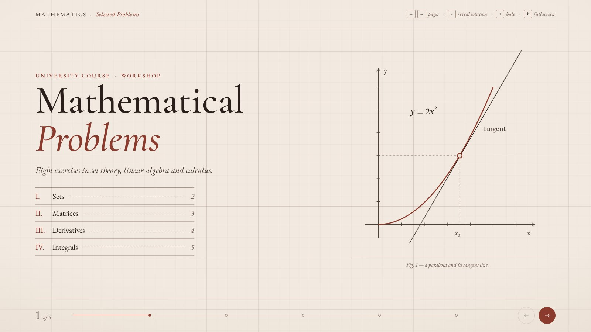
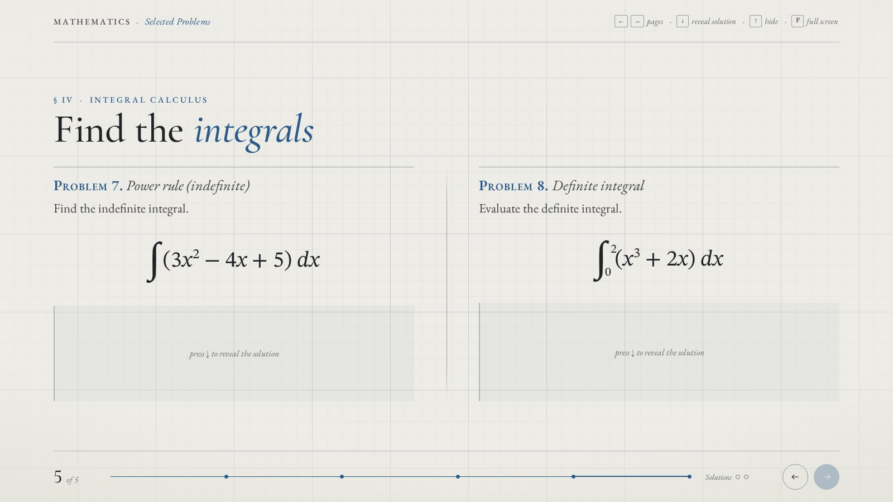
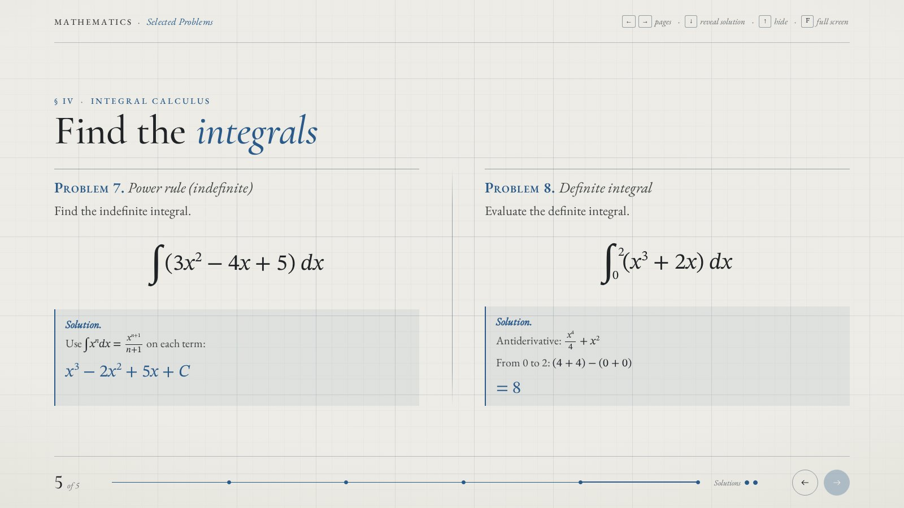
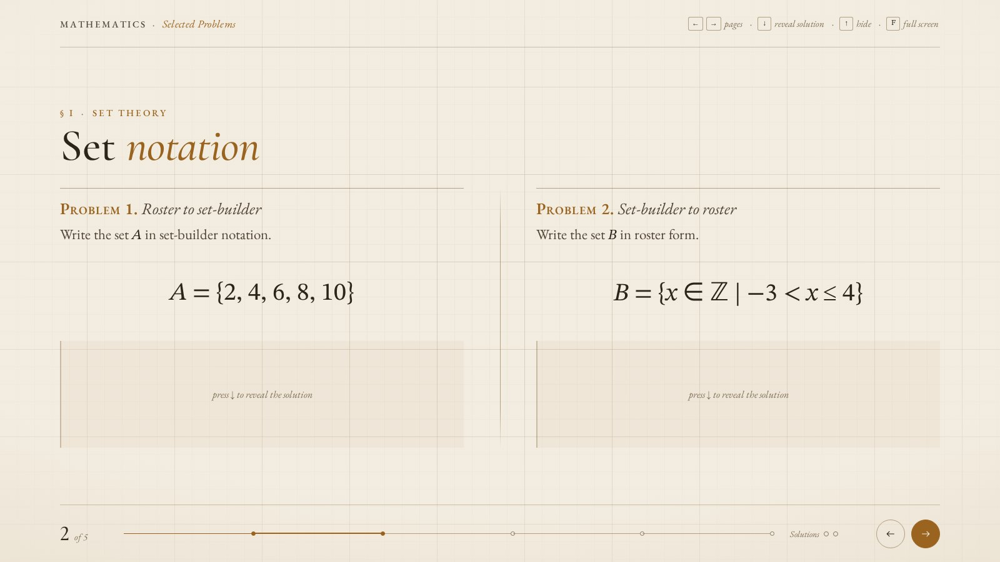
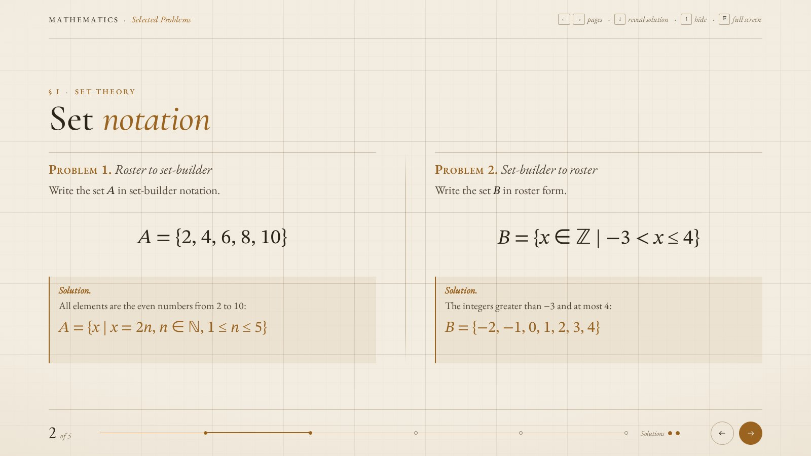
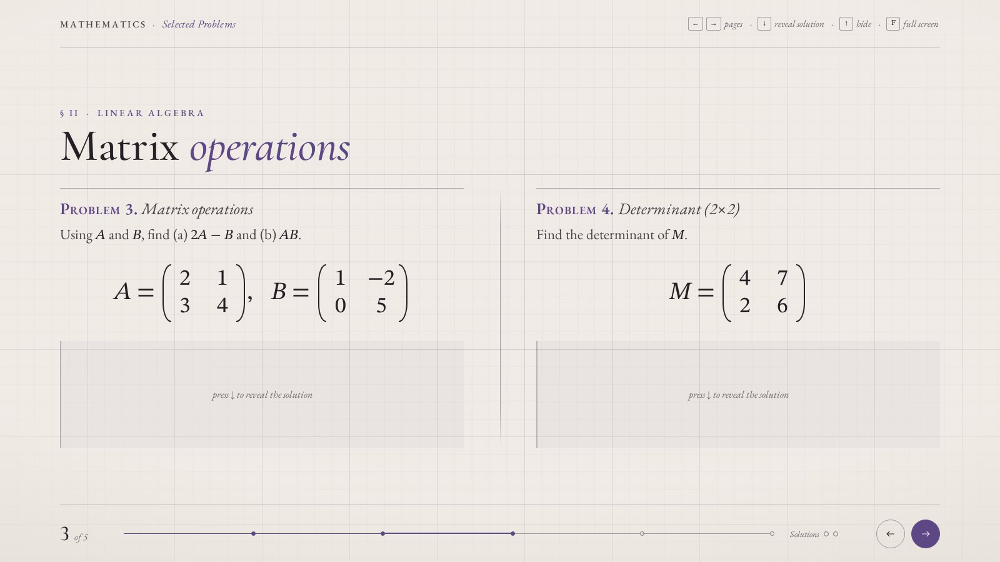
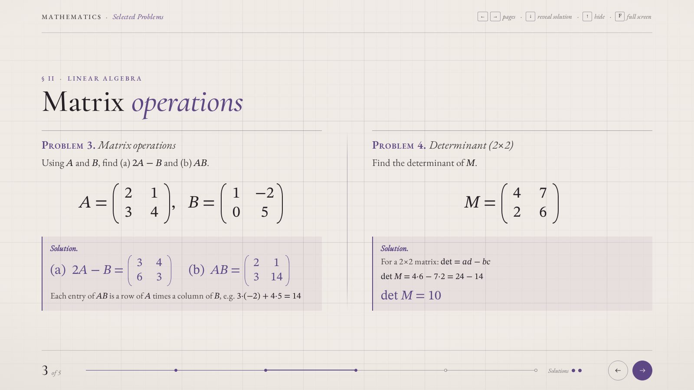
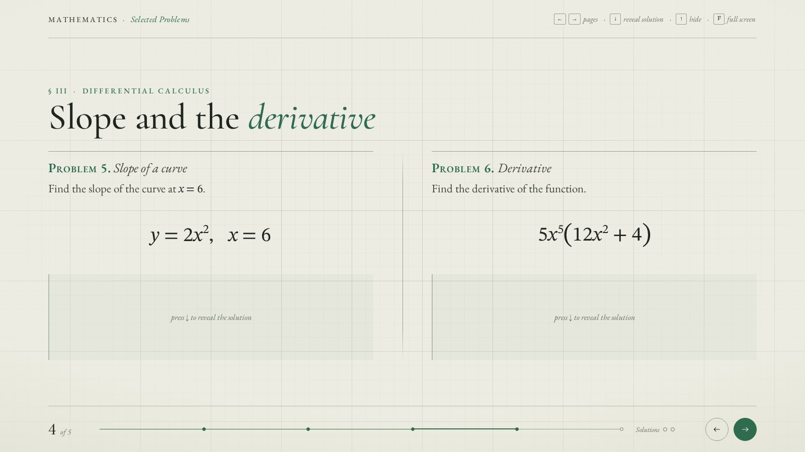
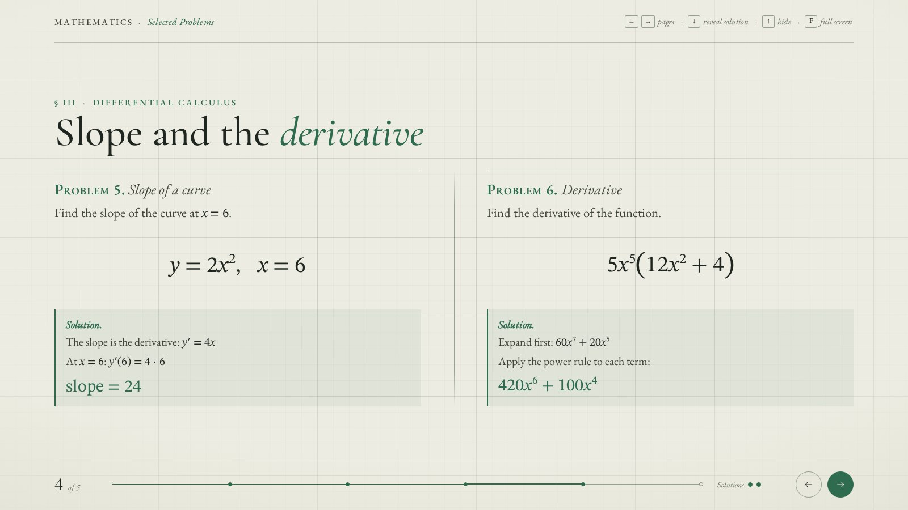
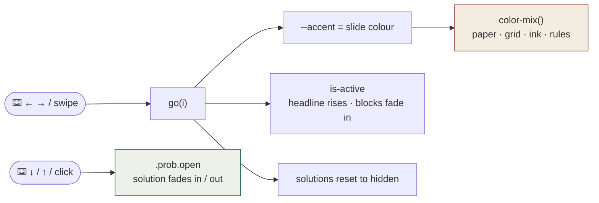

<div align="center">



# 📐 Mathematical Problems

### Eight exercises in set theory, linear algebra and calculus: an interactive, textbook-style slide deck

*Ivory paper, serif type and a faint graph-paper grid. Two problems per page,<br>with solutions that stay hidden until you press <kbd>↓</kbd>.*

<br>


**[▶ Quick start](#-quick-start)** · **[🎮 Controls](#-controls)** · **[📖 Pages](#-the-pages)** · **[⚙️ How it works](#%EF%B8%8F-how-it-works)** · **[🛠 Customising](#-customising)**

</div>

---

## ✨ Highlights

| | Feature | What it means |
|:-:|---|---|
| 📜 | **Classical textbook look** | Warm paper, a graph-paper grid, thin rules and serif type. Problems are set like a textbook: **Problem 1.** in small caps, then the task, the formula and an italic *Solution.* |
| 🙈 | **Solutions hidden by default** | Each problem keeps a reserved solution box. Press <kbd>↓</kbd> to reveal the solutions one at a time and <kbd>↑</kbd> to hide them again. Nothing else on the page moves. |
| 🎨 | **One ink colour per page** | Oxblood, green, ochre, blue and violet. The paper, grid, rules and text are all tinted by the page's colour, and the whole page fades smoothly to the next colour when you turn the page. |
| ∫ | **Math without a library** | Powers, integral signs with limits, fractions and matrices in round brackets are all built with plain HTML and CSS on the *STIX Two* math font. No KaTeX, no MathJax. |
| 📈 | **Self-drawing figure** | The title page has a "Fig. 1" plate: the parabola `y = 2x²` and its tangent line draw themselves in when the page opens. |
| 🪶 | **Three small files** | `index.html`, `style.css` and `main.js` (about 90 lines). No framework, no bundler, no server. |

---

## 🚀 Quick start

No install, no build, no server. Just open the file:

```bash
# from this folder
xdg-open index.html        # Linux
open index.html            # macOS
start index.html           # Windows
```

Then press <kbd>F</kbd> for full screen and <kbd>→</kbd> to begin.

> [!TIP]
> The deck runs straight from `file://`. Only the three fonts (*Cormorant Garamond*, *EB Garamond* and *STIX Two Text*) come from Google Fonts. Without internet it still works and falls back to Georgia and Times.

---

## 🎮 Controls

| Key | Action |
|:---:|---|
| <kbd>→</kbd> &nbsp; <kbd>Space</kbd> &nbsp; <kbd>PgDn</kbd> | Next page |
| <kbd>←</kbd> &nbsp; <kbd>PgUp</kbd> | Previous page |
| <kbd>↓</kbd> | **Reveal** the next solution on this page |
| <kbd>↑</kbd> | **Hide** the last revealed solution |
| <kbd>Home</kbd> / <kbd>End</kbd> | Jump to first / last page |
| <kbd>F</kbd> | Toggle full screen |
| 🖱 Click a problem | Toggle that problem's solution |
| 👆 Swipe | Next / previous on touch screens |
| 🔗 `index.html#4` | Open directly on page 4, Derivatives (works for `#1` – `#5`) |

Solutions are hidden again whenever you come back to a page. The two small circles marked *Solutions* in the footer show which ones are currently visible.

<table>
<tr>
<td width="50%"></td>
<td width="50%"></td>
</tr>
<tr>
<td align="center"><b>Before</b>: solutions hidden</td>
<td align="center"><b>After</b> <kbd>↓</kbd> <kbd>↓</kbd>: both solutions revealed</td>
</tr>
</table>

---

## 📖 The pages

Each problem page holds the **two problems from one source picture**, with only the problem itself and the instruction for what to do.

| # | Page | Colour | Problems |
|:-:|---|:-:|---|
| 1 | **Mathematical *Problems*** |  | Title page, table of contents, Fig. 1 |
| 2 | **§ I · Set *notation*** |  | **1.** `A = {2, 4, 6, 8, 10}` in set-builder notation · **2.** `B = {x ∈ ℤ \| −3 < x ≤ 4}` in roster form |
| 3 | **§ II · Matrix *operations*** |  | **3.** `2A − B` and `AB` · **4.** Determinant of `M` |
| 4 | **§ III · Slope and the *derivative*** |  | **5.** Slope of `y = 2x²` at `x = 6` · **6.** Derivative of `5x⁵(12x² + 4)` |
| 5 | **§ IV · Find the *integrals*** |  | **7.** `∫(3x² − 4x + 5) dx` · **8.** `∫₀² (x³ + 2x) dx` |

<details>
<summary><b>📸 All pages</b></summary>
<br>

| | |
|:-:|:-:|
|  |  |
| **2 · Sets** | **2 · Sets, solved** |
|  |  |
| **3 · Matrices** | **3 · Matrices, solved** |
|  |  |
| **4 · Derivatives** | **4 · Derivatives, solved** |

</details>

<details>
<summary><b>🔑 Answer key</b> (spoilers)</summary>
<br>

| # | Problem | Answer |
|:-:|---|---|
| 1 | `A = {2, 4, 6, 8, 10}` | **`A = {x \| x = 2n, n ∈ ℕ, 1 ≤ n ≤ 5}`** |
| 2 | `B = {x ∈ ℤ \| −3 < x ≤ 4}` | **`B = {−2, −1, 0, 1, 2, 3, 4}`** |
| 3 | `2A − B`, `AB` | **`2A − B = (3 4; 6 3)`**, **`AB = (2 1; 3 14)`** |
| 4 | `det M`, `M = (4 7; 2 6)` | `4·6 − 7·2` = **10** |
| 5 | Slope of `y = 2x²` at `x = 6` | `y′ = 4x`, so the slope is **24** |
| 6 | `d/dx [5x⁵(12x² + 4)]` | `60x⁷ + 20x⁵` → **`420x⁶ + 100x⁴`** |
| 7 | `∫(3x² − 4x + 5) dx` | **`x³ − 2x² + 5x + C`** |
| 8 | `∫₀² (x³ + 2x) dx` | `[x⁴/4 + x²]₀² = (4 + 4) − 0` = **8** |

</details>

---

## ⚙️ How it works



- **One colour drives the whole page.** Every slide has a `data-accent` colour. `main.js` copies it into the CSS variable `--accent`, and `style.css` mixes all the other colours from it with `color-mix()`: paper, grid lines, ink, rules and solution boxes. Because `--accent` is registered with `@property` as a real `<color>`, the browser can animate it, so the entire page fades from one ink colour to the next.
- **Solutions never shift the layout.** The solution box always takes up its full space. While it is hidden only a quiet italic hint is visible, and revealing it just fades the content in. Nothing above or beside it moves.
- **Math is typeset with CSS.** Small helper classes build the notation on top of the *STIX Two* font:

  | Class | Renders |
  |---|---|
  | `.m` | Math font; `<i>` for italic variables |
  | `<sup>` | Exponents |
  | `.int` + `.lim` | Integral sign, with optional upper/lower limits |
  | `.frac` | Stacked fraction |
  | `.mat` | 2×2 matrix in round brackets (four `<span>`s, row by row) |

- **Gentle motion.** Headlines rise out of a mask, blocks fade in one after another, and the title figure draws itself with `stroke-dashoffset`. If your system has *reduced motion* turned on, all of it is switched off.

### 📁 Project structure

```text
math_presentation/
├── index.html          ← all 5 pages: title + 8 problems with their solutions
├── style.css           ← paper theme, colour mixing, layout, math typesetting
├── main.js             ← navigation, solution reveal, progress bar
├── docs/               ← README screenshots
└── math 1–4 (.png/.jpg) ← source pictures the problems were taken from
```

---

## 🛠 Customising

<details>
<summary><b>➕ Add or edit a problem</b></summary>
<br>

Each problem is one `<article class="prob">` inside a page's `<div class="pair">`:

```html
<article class="prob rv">
  <h3><b>Problem 9.</b> <em>Chain rule</em></h3>
  <p class="task">Find the derivative of the function.</p>
  <div class="math"><span class="m">(3<i>x</i> + 1)<sup>4</sup></span></div>
  <div class="ans">
    <span class="alabel">Solution.</span>
    <p class="step">Outer power times inner derivative:</p>
    <p class="res"><span class="m">12(3<i>x</i> + 1)<sup>3</sup></span></p>
  </div>
</article>
```

`.step` lines are the small working; `.res` is the large, coloured final answer.

</details>

<details>
<summary><b>📄 Add a page</b></summary>
<br>

Copy any `<section class="slide">` and give it a `data-title` (shown in the progress bar tooltip) and a `data-accent` colour. The page counter, progress bar and keyboard navigation pick it up automatically.

```html
<section class="slide" data-title="Limits" data-accent="#7a4a2a">
```

</details>

<details>
<summary><b>🎨 Change the colours</b></summary>
<br>

- **A single page:** edit its `data-accent` in `index.html`. Everything on that page follows.
- **The whole theme:** the base paper and ink tones are at the top of `style.css`:

```css
--paper:color-mix(in srgb,var(--accent) 5%,#f7f3ea);
--ink:color-mix(in srgb,var(--accent) 12%,#1d1b18);
```

Raise the percentages for a stronger tint, lower them for a plainer page.

</details>

---

## 💡 Presenting tips

1. Open the deck and press <kbd>F</kbd> before you start. The title figure draws itself in about two seconds.
2. Read each problem aloud and give the audience a moment to try it.
3. Press <kbd>↓</kbd> once to reveal the left solution, then again for the right one. Press <kbd>↑</kbd> if you revealed one too early.
4. To return to a page for a question, use <kbd>←</kbd> or add `#N` to the URL. The solutions will be hidden again.

---

<div align="center">

*“Mathematics is not about numbers, equations, computations, or algorithms: it is about understanding.”*<br>
<sub>— William Paul Thurston</sub>

<sub>Made with plain HTML, CSS & JavaScript · No frameworks · No build step</sub>

</div>
